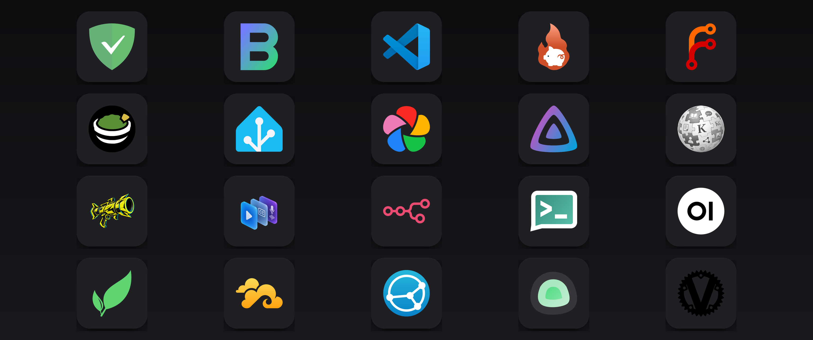

<p align="center">
  
</p>

<h1 align="center">
setup-server
</h1>

<p align="center">
  <strong>One-shot, idempotent deploy scripts for a self-hosted home server that lives only on your tailnet.</strong>
</p>

<p align="center">
  <a href="https://github.com/c-wenlong/setup-server/actions/workflows/ci.yml"></a>
  <a href="https://app.codecov.io/gh/c-wenlong/setup-server"></a>
  <a href="LICENSE"></a>
  
  
  
</p>

<p align="center">
  <a href="#services">Services</a> ·
  <a href="#quick-start">Quick start</a> ·
  <a href="#layout">Layout</a> ·
  <a href="#conventions">Conventions</a> ·
  <a href="#testing">Testing</a> ·
  <a href="#contributing">Contributing</a>
</p>

---

**setup-server** turns each self-hosted service into a single script you can run
and re-run. Every service lives in its own directory and deploys independently:
copy that directory to the target server, run its `setup.sh`, and you get an
installed, configured, boot-persistent service published over HTTPS to your
Tailscale network and nowhere else.

Nothing binds to LAN or internet interfaces, there are no passwords to invent,
and every script ships with a mocked test suite that runs the real `setup.sh`
in a sandbox, so you can validate a deploy before it touches a real machine.

## Services

Same four buckets as the launcher and Homepage. Each row is still a
one-shot deploy.

### Daily

| Service | What it gives you | Deploy |
|---|---|---|
| <a href="https://docs.immich.app/"></a> [immich](services/immich/) | Self-hosted Google Photos: timeline, albums, phone background backup, optional face/semantic search (Docker) | `cd services/immich && ./setup.sh` |
| <a href="https://manual.seafile.com/latest/"></a> [seafile](services/seafile/) | Self-hosted Drive: file sync + web UI + mobile photo backup (Docker) | `cd services/seafile && ./setup.sh` |
| <a href="https://docs.syncthing.net/"></a> [syncthing](services/syncthing/) | Peer-to-peer folder sync between this box, laptop and phone — no server-side drive, no third-party relays or discovery; native binary, pinned, systemd user unit | `cd services/syncthing && ./setup.sh` |
| <a href="https://github.com/dani-garcia/vaultwarden/wiki"></a> [vaultwarden](services/vaultwarden/) | Password manager — Bitwarden-compatible server for the official Bitwarden apps; SQLite, ~12 MB, admin panel off (Docker) | `cd services/vaultwarden && ./setup.sh` |
| <a href="https://coder.com/docs/code-server"></a> [code-server](services/code-server/) | VS Code (with terminal) in the browser, tailnet-only over HTTPS | `cd services/code-server && ./setup.sh` |
| <a href="https://docs.paperless-ngx.com/"><picture><source media="(prefers-color-scheme: dark)" srcset="app/web/static/icons/paperless-ngx-dark.svg"></picture></a> [paperless-ngx](services/paperless-ngx/) | OCR'd, searchable archive of receipts, contracts and tax docs; SQLite + redis, ~654 MiB (Docker) | `cd services/paperless-ngx && ./setup.sh` |
| <a href="https://docs.stirlingpdf.com/Installation/Docker%20Install/"></a> [stirling-pdf](services/stirling-pdf/) | PDF toolbox — merge, split, compress, OCR, convert; single container, login off, loopback-only | `cd services/stirling-pdf && ./setup.sh` |
| <a href="https://docs.firefly-iii.org/"></a> [firefly-iii](services/firefly-iii/) | Personal finance — accounts, budgets, categories, reports; app + Postgres + Data Importer, ~180 MB (Docker) | `cd services/firefly-iii && ./setup.sh` |
| <a href="https://developers.plane.so/self-hosting/overview"></a> [plane](services/plane/) | Project management — issues, cycles, pages (Linear/Jira-shaped); Community stack, loopback-only | `cd services/plane && ./setup.sh` |

### AI & automation

| Service | What it gives you | Deploy |
|---|---|---|
| <a href="https://docs.openwebui.com/"><picture><source media="(prefers-color-scheme: dark)" srcset="app/web/static/icons/open-webui-dark.svg"></picture></a> [open-webui](services/open-webui/) | ChatGPT-style UI over the host's ollama models (Docker, host net) | `cd services/open-webui && ./setup.sh` |
| <a href="https://github.com/paperclipai/paperclip"><picture><source media="(prefers-color-scheme: dark)" srcset="app/web/static/icons/paperclip-dark.svg"></picture></a> [paperclip](services/paperclip/) | Paperclip agent control plane (`claude_local` / `codex_local`); official managed CLI, authenticated/private, tailnet-only | `cd services/paperclip && ./setup.sh` |
| <a href="https://docs.openhands.dev/"></a> [openhands](services/openhands/) | OpenHands Agent Canvas (browser UI for Claude Code / Codex via ACP); official image, `--public` + API key, tailnet-only | `cd services/openhands && ./setup.sh` |
| [quiver-hub](services/quiver-hub/) | Quiver's remote-control hub (`swe remote serve`): watch and steer coding-agent sessions from a phone PWA (sessions, inbox, usage), laptops join as satellites; pinned uv install, systemd user unit, tailnet-only | `cd services/quiver-hub && ./setup.sh` |
| <a href="https://docs.n8n.io/"></a> [n8n](services/n8n/) | Workflow automation (self-hosted Zapier) wired to local services (Docker) | `cd services/n8n && ./setup.sh` |
| <a href="https://trigger.dev/docs/self-hosting/overview"></a> [trigger-dev](services/trigger-dev/) | Background jobs and cron (Trigger.dev v4): TypeScript tasks, dashboard, local registry; slim stack, tailnet-only | `cd services/trigger-dev && ./setup.sh` |
| <a href="https://github.com/c-wenlong/manimkc"></a> manimkc | Narrated ManimGL explainer videos from a JSON brief (HTTP job server; lives in the [manimkc repo](https://github.com/c-wenlong/manimkc) at `server/`) | `~/dev/manimkc/server/setup.sh` |

### Knowledge & media

| Service | What it gives you | Deploy |
|---|---|---|
| <a href="https://appflowy.com/docs/Step-by-step-Self-Hosting-Guide---From-Zero-to-Production"></a> [appflowy](services/appflowy/) | Notion alternative — docs, databases, wiki; AppFlowy Cloud behind nginx, loopback-only; AI and search indexer left out | `cd services/appflowy && ./setup.sh` |
| <a href="https://www.metabase.com/docs/latest/installation-and-operation/running-metabase-on-docker"></a> [metabase](services/metabase/) | BI — dashboards and SQL over databases on this box; OSS + Postgres, first admin seeded | `cd services/metabase && ./setup.sh` |
| <a href="https://github.com/c-wenlong/kaichenpedia"></a> [kaichenpedia](services/kaichenpedia/) | Personal wiki (Quartz static site), auto-deploys from GitHub via a daily poller (Docker nginx) | `cd services/kaichenpedia && ./setup.sh` |
| <a href="https://github.com/c-wenlong/self-learn"></a> [gnosia-learn](services/gnosia-learn/) | Gnosia study hub — Next.js roadmap + tutoring loop over a SQLite catalog, from the private self-learn repo; native `next start`, no database container, auto-deploys via deployd | `cd services/gnosia-learn && ./setup.sh` |
| [deployd](services/deployd/) | Push-to-deploy for a box GitHub can't reach: one poller pulls the checkout, watches each service's `deploy` block in its app.json, runs the service's deploy command when its remote ref moves | `cd services/deployd && ./setup.sh` |
| <a href="https://github.com/c-wenlong/sources"></a> [sources](services/sources/) | Encrypted browser for the private sources archive (transcripts, blogs, newsletters, papers) — same build as the GitHub Pages site; Docker nginx + daily poller over the fetch clone at `~/dev/sources` | `cd services/sources && SITE_PASSPHRASE='...' ./setup.sh` |
| <a href="https://github.com/c-wenlong/designs"></a> [design-systems](services/design-systems/) | Gallery + docs site of the private designs repo — every captured design system's tokens, screenshots and scorecard; same build as `make serve`, unencrypted on the tailnet by design; Docker nginx + daily poller over the working clone at `~/dev/design-systems` | `cd services/design-systems && ./setup.sh` |
| <a href="https://jellyfin.org/"></a> [jellyfin](services/jellyfin/) | Media server — films, shows, music to browser/phone/TV; software transcode by default, opt-in NVENC via enable-nvenc.sh, read-only media mount (Docker) | `cd services/jellyfin && ./setup.sh` |
| <a href="https://forgejo.org/"></a> [forgejo](services/forgejo/) | Self-hosted git forge — repos, PRs, issues; v15 LTS, SQLite, ~100 MB (Docker) | `cd services/forgejo && ./setup.sh` |

### Infrastructure

| Service | What it gives you | Deploy |
|---|---|---|
| <a href="app/web/"></a> [launcher](app/web/) | One-tap app launcher for every service on the box: box health (memory, disk, load) above a Running / Stopped / Not installed list with start, stop and install on each row (Python stdlib, systemd user unit) | `cd app/web && ./setup.sh` |
| <a href="https://gethomepage.dev/"></a> [homepage](services/homepage/) | YAML-configured dashboard of every service, with live status dots and widgets — a read-only front door alongside the launcher (Docker) | `cd services/homepage && ./setup.sh` |
| <a href="https://coolify.io/docs/get-started/installation"></a> [coolify](services/coolify/) | Self-hosted PaaS (Heroku/Vercel-style deploys) — dashboard + Postgres + Redis + Soketi; loopback-only, Traefik proxy off | `cd services/coolify && ./setup.sh` |
| <a href="https://docs.umami.is/docs/install"></a> [umami](services/umami/) | Web analytics — privacy-respecting pageviews; Postgres, default admin/umami password rotated on first boot | `cd services/umami && ./setup.sh` |
| <a href="https://adguard.com/en/adguard-home/overview.html"></a> [adguard](services/adguard/) | Tailnet-wide DNS ad/tracker blocking — every device, no per-device app; needs one manual step in the Tailscale console to take effect (Docker) | `cd services/adguard && ./setup.sh` |
| <a href="https://www.home-assistant.io/"></a> [home-assistant](services/home-assistant/) | Local-first home automation — lights, plugs, sensors, media players, with LAN device discovery (Docker, host net) | `cd services/home-assistant && ./setup.sh` |
| <a href="https://uptime.kuma.pet/"></a> <a href="https://docs.ntfy.sh/"></a> [monitoring](services/monitoring/) | Uptime Kuma dashboard + ntfy phone alerts for every service (Docker, host net) | `cd services/monitoring && ./setup.sh` |
| [ntfy-control](services/ntfy-control/) | Start/stop services from the ntfy phone app (allowlisted commands; auto-pauses Kuma monitors) | `cd services/ntfy-control && ./setup.sh` |
| <a href="https://beszel.dev/"></a> [beszel](services/beszel/) | Resource monitoring — CPU/RAM/GPU/disk/network/temperature graphs + alerts (Docker hub + native agent) | `cd services/beszel && ./setup.sh` |
| <a href="https://guacamole.apache.org/"></a> [remote-desktop](services/remote-desktop/) | This box's GNOME desktop in a browser tab — Guacamole + gnome-remote-desktop; **needs sudo** (configures a system daemon) | `cd services/remote-desktop && ./setup.sh` |

Future service ideas live in [EXPLORATION.md](EXPLORATION.md).
The live deployment (every running service, port map, credentials pointers) is
documented in [DIRECTORY.md](DIRECTORY.md); keep it updated when adding
services.

## Quick start

Clone the repo on the server, pick a service, run its script:

```bash
git clone https://github.com/c-wenlong/setup-server.git
cd setup-server/services/code-server
./setup.sh
```

`setup.sh` is the only entrypoint. It runs preflight checks, installs the
software, writes config (never over a config you edited), makes it
boot-persistent (a systemd user unit on Linux or a launchd LaunchAgent on macOS
for native services, a Docker restart policy for the Compose-based ones),
publishes the local port with `tailscale serve`, then verifies the service end
to end over HTTPS. The last thing it prints is where to open the service and
how to manage it:

```
Done. Open https://<your-host>.ts.net from any device on your tailnet.

Manage it with:
  systemctl --user status|restart code-server
  journalctl --user -u code-server -f
  tailscale serve status        # or: tailscale serve --https=443 off
```

Every service follows this shape. [code-server](services/code-server/setup.sh) is the
reference implementation for a native service and [forgejo](services/forgejo/setup.sh)
for the Docker shape: read one of those first if you want to see how a script
is put together. Re-running any `setup.sh` upgrades or repairs the deployment rather
than rebuilding it, so it is the normal way to apply a change.

### Prerequisites (all services)

- Linux server with systemd, or macOS (services run as launchd LaunchAgents;
  macOS support is portable by construction, so far verified only on Linux)
- Tailscale installed and logged in (`sudo tailscale up` / the macOS app)
- `curl` (plus Docker Desktop or OrbStack on macOS for Docker-based services)

## Layout

Services live in `services/<service>/`. Front ends for the box live in
`app/`: `app/web/` is the launcher. Every service directory contains:

```
services/<service>/
  setup.sh            # idempotent one-shot deploy, the single entrypoint
  SETUP.md            # architecture, security model, dependencies, deploy + ops
  TROUBLESHOOT.md     # layered triage guide for when things break
  docker-compose.yml  # Docker-based services only (most of them)
  tests/
    run-tests.sh      # mocked suite (safe anywhere) + --live verification
    stubs/            # PATH stubs the mocked suite runs setup.sh against
```

## Conventions

- **`setup.sh` is idempotent.** Re-running upgrades/repairs; it never clobbers
  an existing user-edited config.
- **Run as a regular user.** Scripts self-escalate with `sudo` only for the
  few commands that need it, and say so before prompting.
- **Tailnet is the security boundary.** Services bind to `127.0.0.1` and are
  published via Tailscale Serve, so nothing listens on LAN or internet
  interfaces, and Tailscale device auth replaces passwords.
- **Tests ship with the service.** `tests/run-tests.sh` runs the real setup
  script against a sandboxed fake server (no system changes) so it can be
  validated before touching a real machine; `--live` verifies an actual
  deployment.

## Testing

```bash
cd services/code-server
./tests/run-tests.sh          # mocked suite, safe on any machine
./tests/run-tests.sh --live   # verify the real deployment on this box
```

The mocked suite runs the real `setup.sh` inside a sandbox: a temporary `$HOME`
plus PATH stubs for every external command the script touches (`tailscale`,
`sudo`, `systemctl`, `curl` and friends). It makes zero changes to the host and
covers fresh install, idempotent re-run, option overrides, interactive approval
paths and preflight failures. The one exception is beszel, whose default layer
is static analysis of `setup.sh` and `docker-compose.yml` rather than a stub
sandbox, so it ships no `tests/stubs/`.

`--live` checks a machine where the service is actually deployed: the unit
active and enabled with lingering on (or the containers up, for Docker
services), local health endpoint answering, nothing listening off `127.0.0.1`,
publish config present, HTTPS working end to end.

From the repo root, `make test` runs every mocked suite, `make lint` runs
shellcheck and the structure check, and `make test-live` runs the live suites
on a deployed box.

CI runs shellcheck over the scripts, every service's mocked suite, and the
Python tests with coverage. See [CONTRIBUTING.md](CONTRIBUTING.md) for the bar
a change has to clear.

## Adding a new service

Copy the layout above, keep `setup.sh` idempotent and localhost-bound plus
Tailscale-published unless there is a strong reason otherwise, and add a row to
the table here. [AGENTS.md](AGENTS.md) has the full checklist and the
non-negotiable conventions; [CONTRIBUTING.md](CONTRIBUTING.md) covers how to
get the change reviewed and merged.

## Contributing

Issues and pull requests are welcome: [CONTRIBUTING.md](CONTRIBUTING.md)
explains the workflow and the tests a PR needs, and notable changes are
recorded in [CHANGELOG.md](CHANGELOG.md).

Please report security problems privately instead of opening an issue, as
described in [SECURITY.md](SECURITY.md).

## License

MIT, see [LICENSE](LICENSE).
