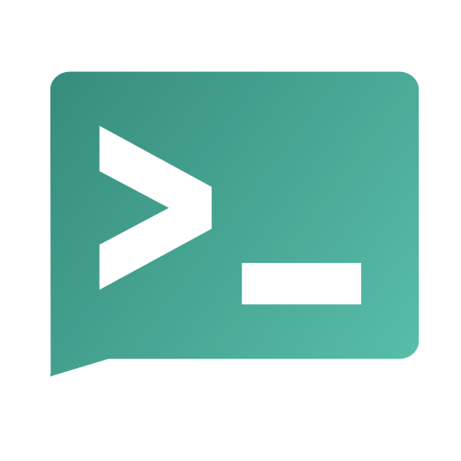

# setup-server

One-shot, repeatable setup scripts for self-hosted services on private
(Tailscale) home servers. Each service lives in its own directory and can be
deployed independently by copying that directory to the target server and
running its `setup.sh`.

## Services

| Service | What it gives you | Deploy |
|---|---|---|
| <a href="https://coder.com/docs/code-server"></a> [code-server](code-server/) | VS Code (with terminal) in the browser, tailnet-only over HTTPS | `cd code-server && ./setup.sh` |
| <a href="https://manual.seafile.com/latest/"></a> [seafile](seafile/) | Self-hosted Drive: file sync + web UI + mobile photo backup (Docker) | `cd seafile && ./setup.sh` |
| <a href="https://docs.syncthing.net/"></a> [syncthing](syncthing/) | Peer-to-peer folder sync between this box, laptop and phone — no server-side drive, no third-party relays or discovery; native binary, pinned, systemd user unit | `cd syncthing && ./setup.sh` |
| <a href="https://docs.openwebui.com/"><picture><source media="(prefers-color-scheme: dark)" srcset="launcher/web/icons/open-webui-dark.svg"></picture></a> [open-webui](open-webui/) | ChatGPT-style UI over the host's ollama models (Docker) | `cd open-webui && ./setup.sh` |
| <a href="https://uptime.kuma.pet/"></a> <a href="https://docs.ntfy.sh/"></a> [monitoring](monitoring/) | Uptime Kuma dashboard + ntfy phone alerts for every service (Docker) | `cd monitoring && ./setup.sh` |
| <a href="https://docs.n8n.io/"></a> [n8n](n8n/) | Workflow automation (self-hosted Zapier) wired to local services (Docker) | `cd n8n && ./setup.sh` |
| <a href="https://github.com/c-wenlong/kaichenpedia"></a> [kaichenpedia](kaichenpedia/) | Personal wiki (Quartz static site), auto-deploys from GitHub via a daily poller (Docker nginx) | `cd kaichenpedia && ./setup.sh` |
| [ntfy-control](ntfy-control/) | Start/stop services from the ntfy phone app (allowlisted commands; auto-pauses Kuma monitors) | `cd ntfy-control && ./setup.sh` |
| <a href="https://github.com/c-wenlong/manimkc"></a> manimkc | Narrated ManimGL explainer videos from a JSON brief (HTTP job server; lives in the [manimkc repo](https://github.com/c-wenlong/manimkc) at `server/`) | `~/dev/manimkc/server/setup.sh` |
| <a href="https://beszel.dev/"></a> [beszel](beszel/) | Resource monitoring — CPU/RAM/GPU/disk/network/temperature graphs + alerts (Docker hub + native agent) | `cd beszel && ./setup.sh` |
| <a href="https://docs.immich.app/"></a> [immich](immich/) | Self-hosted Google Photos: timeline, albums, phone background backup, optional face/semantic search (Docker) | `cd immich && ./setup.sh` |
| <a href="https://forgejo.org/"></a> [forgejo](forgejo/) | Self-hosted git forge — repos, PRs, issues; v15 LTS, SQLite, ~100 MB (Docker) | `cd forgejo && ./setup.sh` |
| <a href="https://jellyfin.org/"></a> [jellyfin](jellyfin/) | Media server — films, shows, music to browser/phone/TV; software transcode, read-only media mount (Docker) | `cd jellyfin && ./setup.sh` |
| <a href="https://guacamole.apache.org/"></a> [remote-desktop](remote-desktop/) | This box's GNOME desktop in a browser tab — Guacamole + gnome-remote-desktop; **needs sudo** (configures a system daemon) | `cd remote-desktop && ./setup.sh` |
| <a href="https://docs.paperless-ngx.com/"><picture><source media="(prefers-color-scheme: dark)" srcset="launcher/web/icons/paperless-ngx-dark.svg"></picture></a> [paperless-ngx](paperless-ngx/) | OCR'd, searchable archive of receipts, contracts and tax docs; SQLite + redis, ~659 MB (Docker) | `cd paperless-ngx && ./setup.sh` |
| <a href="https://docs.firefly-iii.org/"></a> [firefly-iii](firefly-iii/) | Personal finance — accounts, budgets, categories, reports; app + Postgres + Data Importer, ~195 MB (Docker) | `cd firefly-iii && ./setup.sh` |
| [homepage](homepage/) | YAML-configured dashboard of every service, with live status dots and widgets — a read-only front door alongside the launcher (Docker) | `cd homepage && ./setup.sh` |
| <a href="https://adguard.com/en/adguard-home/overview.html"></a> [adguard](adguard/) | Tailnet-wide DNS ad/tracker blocking — every device, no per-device app; needs one manual step in the Tailscale console to take effect (Docker) | `cd adguard && ./setup.sh` |
| <a href="https://www.home-assistant.io/"></a> [home-assistant](home-assistant/) | Local-first home automation — lights, plugs, sensors, media players, with LAN device discovery (Docker, host net) | `cd home-assistant && ./setup.sh` |
| <a href="https://github.com/dani-garcia/vaultwarden/wiki"></a> [vaultwarden](vaultwarden/) | Password manager — Bitwarden-compatible server for the official Bitwarden apps; SQLite, ~12 MB, admin panel off (Docker) | `cd vaultwarden && ./setup.sh` |
| <a href="launcher/"></a> [launcher](launcher/) | One-tap app launcher for every service on the box — tile grid with live status, and a Deploy button for services not installed yet (Python stdlib, systemd user unit) | `cd launcher && ./setup.sh` |

Future service ideas live in [EXPLORATION.md](EXPLORATION.md).
The live deployment (every running service, port map, credentials pointers)
is documented in [DIRECTORY.md](DIRECTORY.md) — keep it updated when adding
services.

## Layout — every service directory contains

```
<service>/
  setup.sh          # idempotent one-shot deploy — the single entrypoint
  SETUP.md          # architecture, security model, dependencies, deploy + ops
  TROUBLESHOOT.md   # layered triage guide for when things break
  tests/
    run-tests.sh    # mocked suite (safe anywhere) + --live verification
```

## Conventions

- **`setup.sh` is idempotent.** Re-running upgrades/repairs; it never clobbers
  an existing user-edited config.
- **Run as a regular user.** Scripts self-escalate with `sudo` only for the
  few commands that need it, and say so before prompting.
- **Tailnet is the security boundary.** Services bind to `127.0.0.1` and are
  published via Tailscale Serve — nothing listens on LAN or internet
  interfaces, and Tailscale device auth replaces passwords.
- **Tests ship with the service.** `tests/run-tests.sh` runs the real setup
  script against a sandboxed fake server (no system changes) so it can be
  validated before touching a real machine; `--live` verifies an actual
  deployment.

## Prerequisites (all services)

- Linux server with systemd, or macOS (services run as launchd LaunchAgents;
  macOS support is portable by construction, so far verified only on Linux)
- Tailscale installed and logged in (`sudo tailscale up` / the macOS app)
- `curl` (plus Docker Desktop or OrbStack on macOS for Docker-based services)

## Adding a new service

Copy the layout above (see `AGENTS.md` for the full checklist), keep `setup.sh`
idempotent and localhost-bound + Tailscale-published unless there's a strong
reason otherwise, and add a row to the table here.
